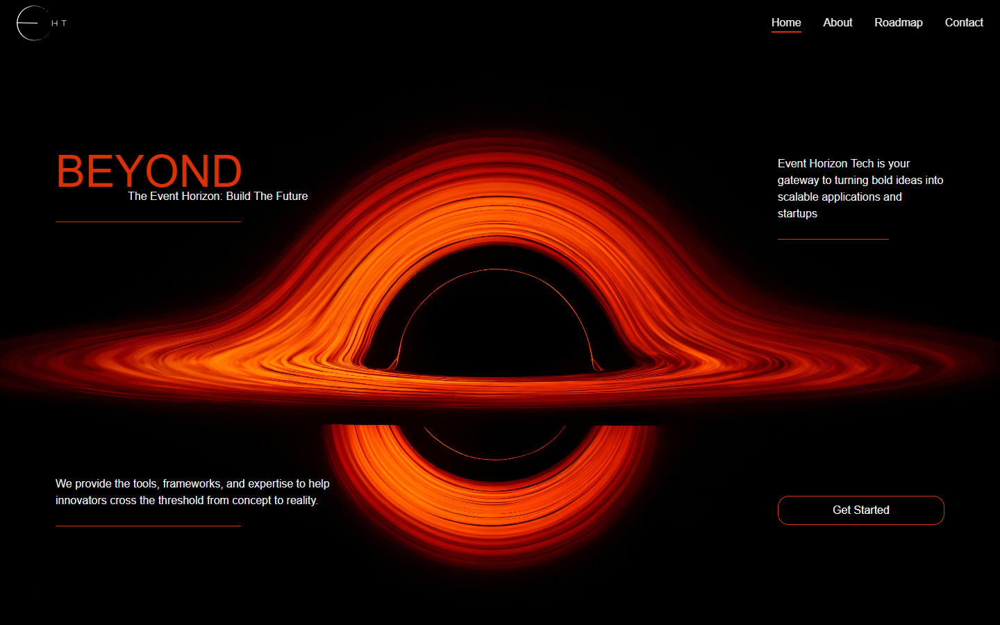

# Event Horizon — team-site fork

A Next.js prototype for the Event Horizon Tech team website, with a black-hole
hero, service/roadmap sections and an image carousel.



## Provenance and status

This is a fork of
[EventHorzionTeam/event-horizon](https://github.com/EventHorzionTeam/event-horizon).
Before this update, fork revision `ffde63d` was 20 commits behind upstream
`3f82aca`, with zero fork-only commits. Shared history includes commits
attributed to Ramtin and the team; this is not presented as sole-authored work.
Upstream branding and contribution history remain intact.

This fork's presentation pass removes an unused dependency that blocked normal
installation and corrects inherited dark text on the fixed dark artwork when
the system prefers light mode. It does not import the newer upstream branch.
Navigation labels and the Get Started control are still presentation placeholders;
no backend, customer usage or current commercial deployment is verified.

## Run this fork

Verified on Windows with Node.js 24.11.1 and npm 11.6.2. The lockfile pins
Next.js 15.3.5 and React 19.1.0; the site also uses Tailwind CSS 4 and GSAP.
No application credentials are required. Google fonts need build-time network.

```sh
git clone https://github.com/boyInShadows/event-horizon.git
cd event-horizon
npm ci
npm run dev
```

Open <http://localhost:3000>. Existing checks and production preview:

```sh
npm run lint
npm run build
npm start
```

The [carousel](app/components/mainPage/section3/imageSlider/index.js) implements
its own previous/next transitions; it does not use the removed `react-slider`
package. Retained package versions were not upgraded.

## Verification and limits

On 2026-10-30, normal locked installation, lint and production build passed
after the unused dependency was removed. Build retains a Turbopack-config
deprecation warning. Edge checks verified previous/next carousel positions,
visible image loading and light/dark system-preference text readability.
The theme regression failed before the correction and passes afterward.

Mobile still overflows: the 390px viewport produced a 723px document. Buttons
and navigation need further accessibility/functionality work. There is no test
script or quality CI. A dated npm audit reported 14 advisories (2 critical,
9 high, 2 moderate, 1 low); production security and live deployment remain
unverified. Bootstrapped with create-next-app; framework, team and asset rights
remain unchanged. No project license is assigned by this update.
